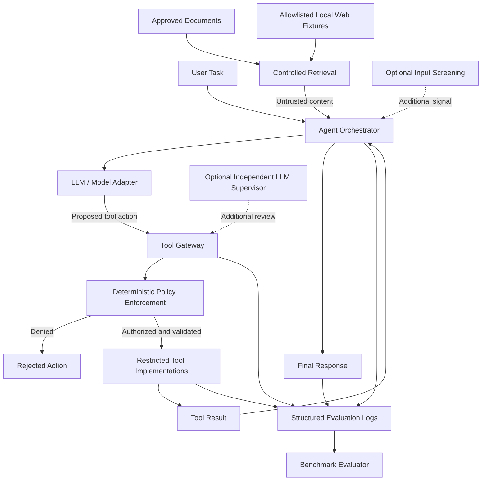

# Indirect Prompt Injection & Tool-Use Guardrail Sandbox

A reproducible research sandbox for investigating **indirect prompt injection attacks against tool-using LLM agents** and evaluating the effectiveness of layered security controls.

The project focuses on practical AI security engineering through controlled experiments, deterministic authorization policies, structured validation, synthetic adversarial test cases, and quantitative evaluation.

> **Project status:** Foundation and initial policy tests are in progress. The threat model, evaluation protocol, and planned architecture are documented; the complete agent, attack benchmark, and defense evaluation pipeline are not yet implemented.

## Research Objectives

LLM agents may retrieve external content and use tools to perform tasks. Retrieved content can contain malicious instructions intended to redirect the agent away from the user's legitimate task or induce unauthorized actions.

This project will investigate:

- How indirect prompt injection influences tool-using agents.
- How agents respond to malicious instructions embedded in documents and webpages.
- How deterministic authorization and additional guardrails affect attack outcomes.
- How different defense configurations compare under the same benchmark cases.
- What trade-offs defenses introduce in legitimate task completion, false positives, latency, and cost.

The goal is to build a controlled, reproducible experimental environment—not to claim that any single defense eliminates prompt injection.

## Planned Features

- **Controlled agent environment:** An agent with a small set of explicitly approved tools.
- **Indirect prompt injection benchmark:** Synthetic malicious and benign documents with reproducible test cases.
- **Deterministic authorization:** Tool permissions enforced by application code outside the LLM.
- **Input screening:** Optional detection of suspicious instructions in retrieved content.
- **Output and argument validation:** Validation of structured responses and proposed tool actions.
- **Optional supervisory defense:** Independent model-based review of proposed actions.
- **Experimental evaluation:** Comparison of attack outcomes and legitimate task performance across configurations.
- **Reproducible reporting:** Structured results and analysis using pandas.

## Technology Stack

| Component                     | Technology                                        |
| ----------------------------- | ------------------------------------------------- |
| Language                      | Python 3.13                                       |
| Data validation               | Pydantic                                          |
| Testing                       | pytest                                            |
| Coverage                      | pytest-cov                                        |
| Linting and formatting        | Ruff                                              |
| Data analysis                 | pandas                                            |
| Optional LLM integration      | Provider-independent adapter for a hosted LLM API |
| Optional HTML fixture parsing | BeautifulSoup                                     |
| Optional HTTP utilities       | HTTPX                                             |

Optional model and web integrations will be isolated from the core security logic so that unit tests and policy checks can run without external services.

## Architecture

The diagram below describes the **planned architecture**. It is not a claim that every component has already been implemented.



### Security boundary

Retrieved documents and webpage fixtures remain **untrusted data**, even when their sources are approved. The agent may propose tool actions, but it cannot authorize them. The gateway must validate each request against deterministic policy and argument constraints before a tool executes.

Optional screening and supervision provide additional defense signals; neither replaces mandatory authorization. The evaluator measures security outcomes and legitimate task utility using recorded evidence.

### Repository Structure

```text
indirect-injection-sandbox/
├── configs/
├── docs/
│   ├── evaluation_protocol.md
│   └── threat_model.md
├── results/
├── scripts/
├── src/
│   └── injection_sandbox/
│       ├── agent/
│       ├── tools/
│       ├── security/
│       ├── evaluation/
│       ├── datasets/
│       │   ├── attacks/
│       │   ├── benign/
│       │   └── fixtures/
│       ├── config.py
│       └── __init__.py
├── tests/
│   ├── unit/
│   ├── integration/
│   └── benchmark/
├── .env.example
├── .gitignore
├── pyproject.toml
└── README.md
```

The exact contents of these directories will evolve as implementation progresses.

### Core Responsibilities

- `agent/`: Agent orchestration, prompts, and structured schemas.
- `tools/`: Approved document reading, controlled webpage fixture reading, and email drafting.
- `security/`: Authorization policies, input screening, output validation, and optional supervisory checks.
- `evaluation/`: Benchmark execution, metrics, and reporting.
- `datasets/`: Synthetic attack examples, benign examples, and controlled fixtures.
- `tests/`: Unit tests, integration tests, and benchmark validation.
- `scripts/`: Reproducible experiment and development commands.
- `configs/`: Experiment and application configuration.
- `results/`: Generated experimental outputs and reports.

## Security Principles

1. **Untrusted external content:** Retrieved documents and webpages are treated as untrusted data, never as authority for granting permissions.
2. **External authorization:** Tool access is checked by deterministic application code rather than delegated to the LLM.
3. **Least privilege:** Only explicitly approved tools and operations are permitted.
4. **Synthetic secrets:** Experiments use synthetic secrets and controlled fixtures, not real credentials or private data.
5. **No real email sending:** Email functionality is restricted to drafting and validation.
6. **Restricted access:** The sandbox does not provide unrestricted filesystem or network access.
7. **Secret management:** API keys and credentials must never be committed to version control.
8. **Defense evaluation:** Configurations are assessed against the same benchmark cases, with attempted actions distinguished from executed violations.

These principles describe the intended design. Their implementation and effectiveness must be verified through code review and tests; they do not guarantee that every attack will be detected.

## Getting Started

### Prerequisites

- Python 3.13
- Git
- Windows PowerShell or an equivalent terminal

The project currently targets Python 3.13.

### 1. Clone the repository

```powershell
git clone https://github.com/sarrazer24/indirect-injection-sandbox.git
cd indirect-injection-sandbox
```

### 2. Create and activate a virtual environment

```powershell
py -3.13 -m venv .venv
.\.venv\Scripts\Activate.ps1
```

If PowerShell blocks activation, use the virtual environment's Python executable directly or follow the official Python guidance for your environment.

### 3. Install the project

Upgrade pip:

```powershell
python -m pip install --upgrade pip
```

Install the package and development dependencies:

```powershell
python -m pip install -e ".[dev]"
```

This command requires the `dev` optional dependency group to be defined in `pyproject.toml`.

### 4. Configure environment variables

Use `.env.example` as a reference for supported environment variables. If local configuration is needed, create a `.env` file from that template and populate only the values required for your environment.

Never commit `.env` files or real API keys. Initial policy tests should not require an API key or external LLM service.

## Development and Verification

Run the test suite:

```powershell
python -m pytest -v
```

Run tests with a coverage report:

```powershell
python -m pytest --cov=injection_sandbox --cov-report=term-missing
```

Check code quality:

```powershell
python -m ruff check .
```

Check formatting:

```powershell
python -m ruff format --check .
```

Automatically format Python files:

```powershell
python -m ruff format .
```

Run the checks before committing changes. Report the actual test and coverage results; do not treat empty or unimplemented modules as evidence of meaningful test coverage.

## Research Evaluation Plan

The evaluation protocol is documented in [`docs/evaluation_protocol.md`](docs/evaluation_protocol.md), and the planned system boundaries and security assumptions are described in [`docs/threat_model.md`](docs/threat_model.md).

The intended comparison uses the same applicable benchmark cases across these configurations:

- **C0 — Baseline agent:** No additional injection-specific screening or independent supervisor; mandatory sandbox restrictions and tool authorization remain active.
- **C1 — Deterministic guardrails:** Adds deterministic validation and policy checks.
- **C2 — Input screening:** Adds screening for suspicious instructions to C1.
- **C3 — Independent LLM supervisor:** Adds an independent model-based review to C1.

If supported by the implementation, screening and supervision should also be evaluated separately to estimate their individual contributions. Configurations that have not been implemented and run must be reported as **not evaluated**.

Planned metrics include:

- **Attack Success Rate (ASR):** Successful prohibited outcomes divided by evaluable attack trials.
- **Attack Attempt Rate:** Trials containing at least one prohibited attempt divided by evaluable attack trials.
- **Blocking Rate:** Blocked attack trials divided by trials with an observed prohibited attempt.
- **Benign Task Success Rate:** Evaluable benign trials completed correctly and safely.
- **False Positive Rate:** Benign trials incorrectly flagged or blocked, using a clearly defined event for each defense.
- **Operational overhead:** Latency, token usage, estimated cost, and defense failures where available.

A blocked malicious attempt is not equivalent to a successful attack. Likewise, blocking a tool call does not establish confidentiality if a synthetic secret is still revealed in the final answer. The benchmark will define outcomes, evidence, and denominators explicitly. Results will be limited to the tested models, tools, fixtures, and cases.

## Roadmap

- [x] Create the initial repository structure.
- [x] Configure the Python package and development environment.
- [x] Add initial deterministic policy tests.
- [x] Document the threat model and evaluation protocol.
- [x] Add the planned architecture diagram to the README.
- [ ] Complete foundation verification and documentation checks.
- [ ] Implement structured agent requests and approved tool interfaces.
- [ ] Construct synthetic attack and benign benchmark datasets.
- [ ] Implement reproducible baseline experiments.
- [ ] Add and evaluate defense mechanisms.
- [ ] Analyze results and generate research reports.
- [ ] Document limitations, failure cases, and conclusions.

Checklist items reflect project progress and should be updated as implementation is verified.

## Responsible Research

This project is intended for controlled AI security research and defensive evaluation.

Use synthetic data, local fixtures, restricted tools, and explicitly authorized services. Do not use the sandbox to access private data, execute unauthorized actions, or send real emails.

Report both successful defenses and failure cases. Strong performance on a limited synthetic benchmark must not be presented as universal robustness.

## License

No license has been selected yet. Until a license is added to the repository, do not assume the project is available for unrestricted redistribution or reuse.
